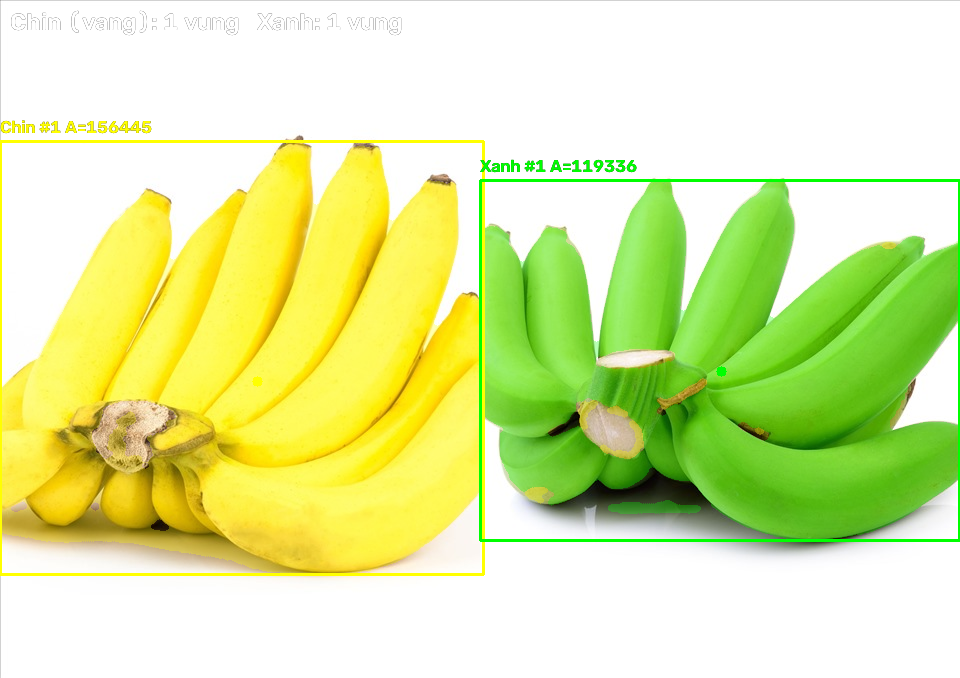
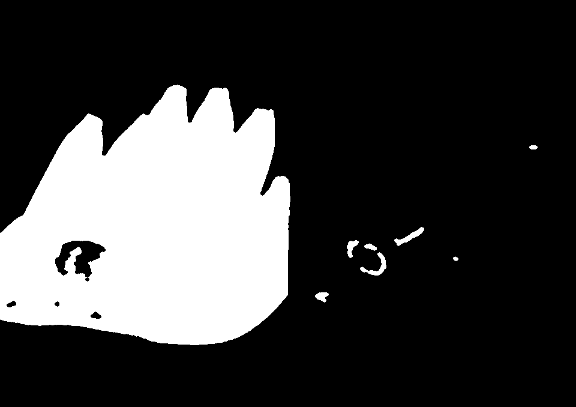

# Bài tập OpenCV: Nhận diện quả chín / quả xanh trong ảnh (BGR)

Chương trình **chỉ xử lý ảnh**. Mặc định đọc ảnh mẫu đi kèm repo:

```
images/chuoixanh_chin2.jpg
```

Mỗi pixel được phân loại trực tiếp từ 3 kênh **B, G, R**:

| Điều kiện | Kết quả |
|-----------|---------|
| `max(R,G,B) < 50` | bỏ qua (quá tối) |
| `max(R,G,B) - min(R,G,B) < 25` | bỏ qua (nền trắng / gần xám) |
| `B > 0.75 * G` | bỏ qua (ánh xanh dương) |
| `G >= 1.06 * R` | **quả xanh** |
| còn lại | **quả chín (vàng)** |

Sau đó tìm contour trên từng mask, lọc theo diện tích và khoanh vùng quả.

## Ảnh mẫu và kết quả

| Ảnh đầu vào | Kết quả | Mask quả chín | Mask quả xanh |
|-------------|---------|---------------|---------------|
|  |  |  |  |

Ảnh mẫu `images/chuoixanh_chin2.jpg` (960×678) nằm trong repo nên có thể chạy
ngay sau khi clone, không cần chuẩn bị ảnh riêng.

## 1. Tính năng

- Đọc ảnh mặc định `images/chuoixanh_chin2.jpg` hoặc ảnh truyền vào.
- Phân loại **quả chín (vàng)** và **quả xanh** bằng tỉ lệ kênh BGR.
- Lọc nhiễu + nối vùng bằng morphology (open + close).
- Tìm vùng bằng `cv::findContours`, lọc theo diện tích tối thiểu (mặc định 3000).
- Tô màu: vàng cho quả chín, xanh lá cho quả xanh; vẽ khung, tâm, nhãn
  `Chin #n A=...` / `Xanh #n A=...`.
- Cửa sổ **"Chỉnh ngưỡng màu"** với 4 trackbar BGR để chỉnh trực tiếp.
- Lưu ảnh kết quả + 2 mask bằng phím `s` hoặc chế độ `--no-gui`.
- Test bằng CTest trên ảnh BGR tổng hợp, không cần ảnh thật.

## 2. Cấu trúc thư mục

```
BaiTap_ChuoiXanhChin/
├── CMakeLists.txt
├── run.bat                       # build + chạy trên Windows/MSYS2
├── images/
│   ├── chuoixanh_chin2.jpg       # ảnh đầu vào mẫu
│   ├── ketqua_chuoi.png          # ảnh kết quả mẫu
│   ├── mask_chin.png             # mask quả chín mẫu
│   └── mask_xanh.png             # mask quả xanh mẫu
├── include/vision/
│   ├── ripeness.hpp              # RgbThresholds + segmentByRipeness
│   ├── fruit_detector.hpp        # phát hiện + vẽ vùng quả
│   └── opencv_compat.hpp         # tương thích OpenCV 4 / 5
├── src/
│   ├── ripeness.cpp
│   ├── fruit_detector.cpp
│   └── main.cpp                  # đọc ảnh, trackbar, lưu kết quả
└── tests/
    ├── test_util.hpp
    ├── test_ripeness.cpp
    └── test_fruit_detector.cpp
```

## 3. Yêu cầu

- CMake >= 3.16, trình biên dịch C++17
- OpenCV >= 4.x (`find_package(OpenCV)`)

Windows (MSYS2 MinGW64):

```bat
pacman -S mingw-w64-x86_64-cmake mingw-w64-x86_64-gcc mingw-w64-x86_64-opencv
```

## 4. Build và chạy

Cách nhanh trên Windows:

```bat
run.bat
run.bat --no-gui
```

Hoặc build thủ công:

```bash
cmake -S . -B build -DCMAKE_BUILD_TYPE=Release
cmake --build build -j
```

```bat
build\detect.exe                                  REM ảnh mẫu trong repo
build\detect.exe images\chuoixanh_chin2.jpg
build\detect.exe --no-gui
build\detect.exe --min-area 5000
build\detect.exe -h
```

## 5. Tham số dòng lệnh

| Tham số | Ý nghĩa |
|---------|----------|
| `<ảnh>` | Ảnh đầu vào (mặc định `images/chuoixanh_chin2.jpg`) |
| `-o`, `--out <path>` | Ảnh kết quả (mặc định `ketqua_chuoi.png`) |
| `--mask-chin <path>` | Mask quả chín (mặc định `mask_chin.png`) |
| `--mask-xanh <path>` | Mask quả xanh (mặc định `mask_xanh.png`) |
| `-m`, `--min-area <n>` | Diện tích contour tối thiểu (mặc định 3000) |
| `--no-gui` | Không mở cửa sổ, lưu ảnh rồi thoát |
| `-h`, `--help` | Hiển thị hướng dẫn |

## 6. Phím điều khiển (chế độ GUI)

| Phím | Chức năng |
|------|-----------|
| `q` / `ESC` | Thoát |
| `s` | Lưu ảnh kết quả + 2 mask |
| `m` | Đổi ngưỡng diện tích (3000 / 10000) |
| `r` | Reset 4 ngưỡng BGR về mặc định |

Trackbar trong cửa sổ **"Chỉnh ngưỡng màu"**:

| Trackbar | Mặc định | Ý nghĩa |
|----------|----------|----------|
| `G/R xanh` | 106 | `G/R >= 1.06` → quả xanh |
| `B/G tối đa` | 75 | `B/G > 0.75` → bỏ qua |
| `Sáng tối thiểu` | 50 | `max(R,G,B) >= 50` |
| `Chênh màu` | 25 | `max-min >= 25` |

## 7. Cách hoạt động

```
ảnh BGR
  → đọc từng pixel (B, G, R)
  → loại pixel tối / nền trắng / ánh xanh dương
  → G/R >= 1.06 ? mask xanh : mask chín
  → morphologyEx(open) + morphologyEx(close)
  → findContours → contourArea >= minArea
  → boundingRect + moments
  → tô màu, vẽ khung, lưu kết quả
```

### Vì sao dùng `G/R` và `B/G`?

- **`G/R`** tách quả chín và quả xanh:
  - Quả chín (vàng) có `R` và `G` khá gần nhau, nên `G/R` nhỏ (khoảng 0.85–1.0).
  - Quả xanh có `G` lớn hơn `R` rõ rệt, nên `G/R` lớn (thường > 1.1).
  - Ngưỡng 1.06 nằm giữa hai nhóm.
- **`B/G`** loại các vùng ám xanh dương (nền, phản sáng, vật thể lạ):
  - Pixel có `B` quá cao so với `G` không đại diện cho vỏ chuối vàng/xanh.
  - Ngưỡng 0.75 loại pixel có `B > 0.75 × G`.
- **Độ sáng và chênh màu** loại nền:
  - `max(R,G,B) < 50`: vùng quá tối, màu không đáng tin cậy.
  - `max - min < 25`: nền trắng/xám vì ba kênh gần bằng nhau.

### Ví dụ tính tay

Giả sử pixel có thứ tự **(B, G, R)**:

| Pixel | Giá trị (B,G,R) | `max` | `max-min` | `B/G` | `G/R` | Kết quả |
|-------|------------------|-------|-----------|-------|-------|---------|
| Vàng chín | (0, 220, 240) | 240 | 240 | 0.00 | 0.92 | **Quả chín** |
| Xanh lá | (50, 200, 130) | 200 | 150 | 0.25 | 1.54 | **Quả xanh** |
| Nền trắng | (255, 255, 255) | 255 | 0 | 1.00 | 1.00 | **Bỏ qua** |

Cách đọc từng dòng:

- **Vàng chín**: đủ sáng (`240 >= 50`), đủ chênh màu (`240 >= 25`),
  không ám xanh dương (`0 <= 165`), và `G/R = 0.92 < 1.06` → quả chín.
- **Xanh lá**: đủ sáng, đủ chênh màu, `B/G = 0.25 <= 0.75`, và
  `G/R = 1.54 >= 1.06` → quả xanh.
- **Nền trắng**: `max-min = 0 < 25` nên bị loại ngay từ bước chênh màu.

## 8. Cách chọn ngưỡng với ảnh khác

Thứ tự chỉnh nên làm: **độ sáng/chênh màu → B/G → G/R → diện tích**.

| Hiện tượng | Cách chỉnh |
|------------|------------|
| Nền trắng/xám bị nhận là quả | Tăng `Chênh màu` (30–50) |
| Vùng tối, bóng đổ bị nhận là quả | Tăng `Sáng tối thiểu` (60–80) |
| Quả tối màu bị bỏ qua | Giảm `Sáng tối thiểu` (30–40) |
| Nền xanh dương lọt vào mask | Giảm `B/G tối đa` (0.60–0.70) |
| Quả xanh bị bỏ qua vì ám xanh dương | Tăng `B/G tối đa` (0.80–0.90) |
| Quả vàng bị nhận thành quả xanh | Tăng `G/R xanh` (1.08–1.12) |
| Quả xanh nhạt bị nhận thành quả chín | Giảm `G/R xanh` (1.00–1.04) |
| Nhiều đốm nhỏ bị khoanh | Tăng `--min-area` (5000–10000) |
| Quả nhỏ không được phát hiện | Giảm `--min-area` (500–2000) |

Quy trình gợi ý:

1. Chạy `run.bat`, quan sát cửa sổ **"Chỉnh ngưỡng màu"**.
2. Chỉnh `Sáng tối thiểu` và `Chênh màu` để loại nền trước.
3. Chỉnh `B/G tối đa` nếu nền hoặc vật thể ám xanh dương còn lọt.
4. Chỉnh `G/R xanh` cuối cùng để tách quả chín / quả xanh.
5. Nhấn `m` để đổi nhanh ngưỡng diện tích, nhấn `r` để reset.
6. Nhấn `s` để lưu kết quả, hoặc chạy `--no-gui` để xử lý một lần.

## 9. Kết quả với ảnh mẫu

Với `images/chuoixanh_chin2.jpg` (960×678), cách phân loại này cho:

- **1 vùng quả chín** (nửa trái ảnh, diện tích ~156.445 pixel).
- **1 vùng quả xanh** (nửa phải ảnh, diện tích ~119.336 pixel).

Lưu ý: chương trình nhận diện **vùng quả chín / vùng quả xanh**, không đếm từng
quả riêng lẻ bên trong chùm.

## 10. Test

```bash
cmake -S . -B build
cmake --build build -j
ctest --test-dir build --output-on-failure
```

- `test_ripeness`: kiểm tra phân loại pixel vàng/xanh, loại nền trắng, vật xanh
  dương, pixel tối, nhiễu 1 pixel và thay đổi ngưỡng G/R.
- `test_fruit_detector`: kiểm tra phát hiện 1 vùng chín + 1 vùng xanh, lọc
  `minArea`, sắp xếp và vẽ kết quả.
