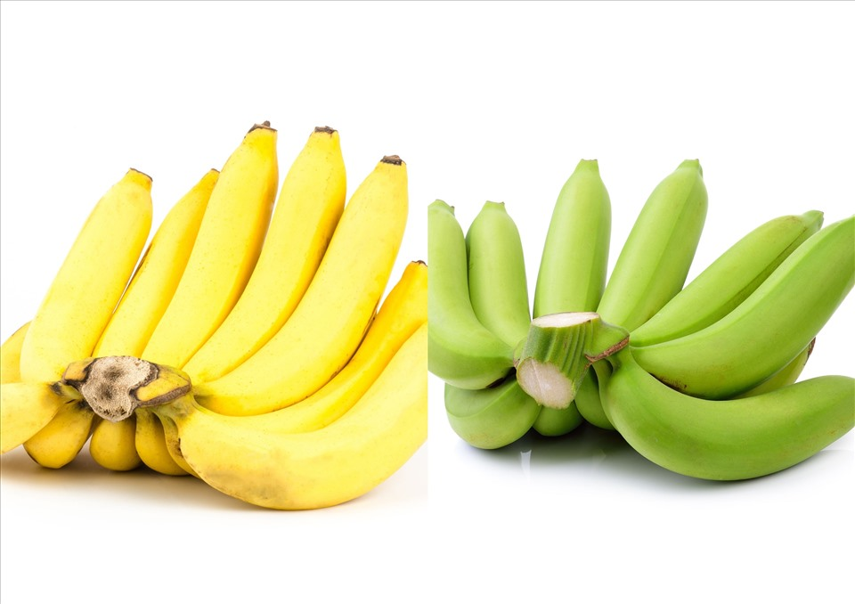
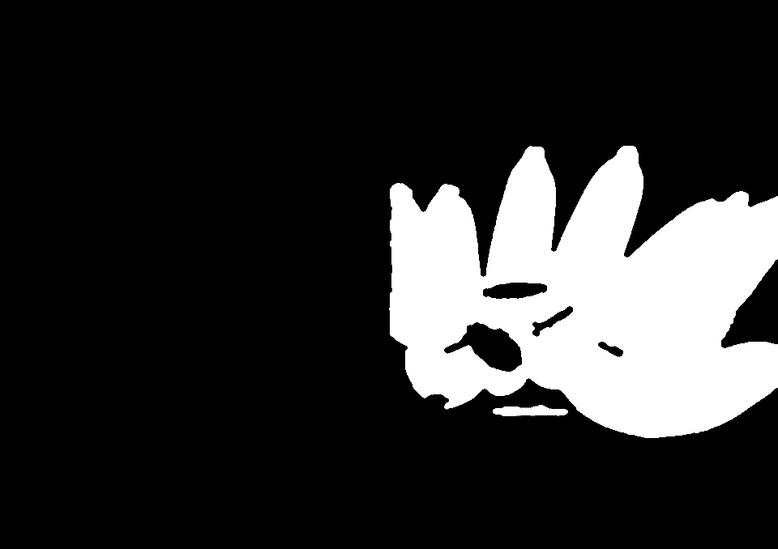
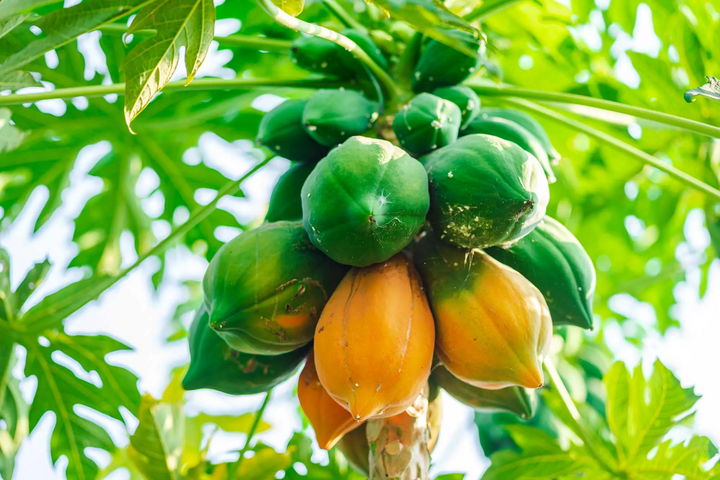
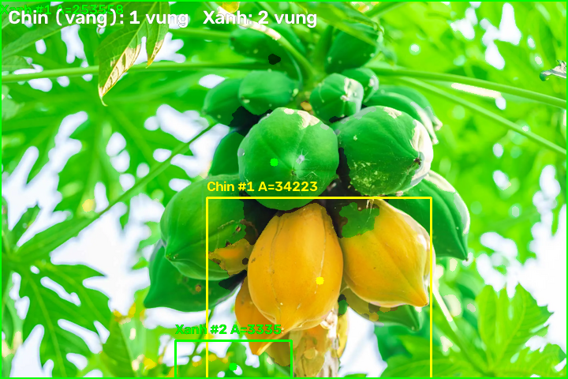
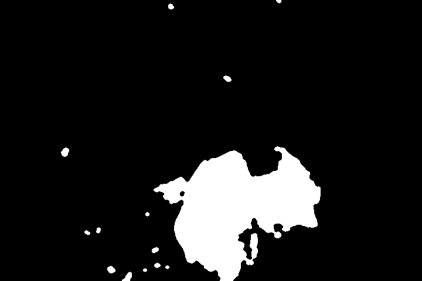
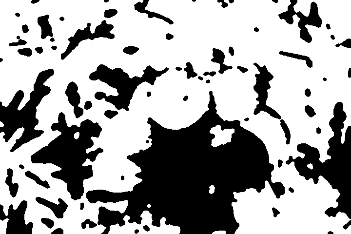
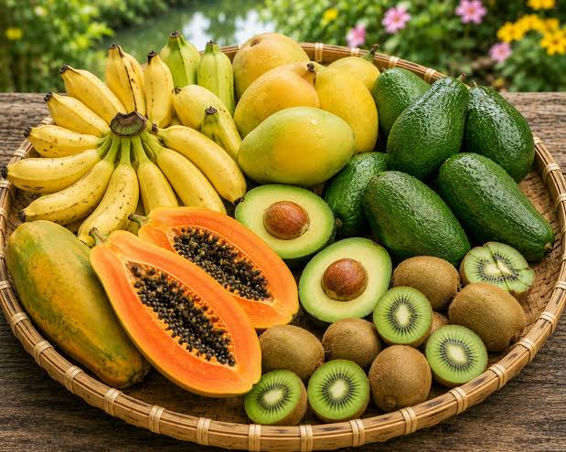
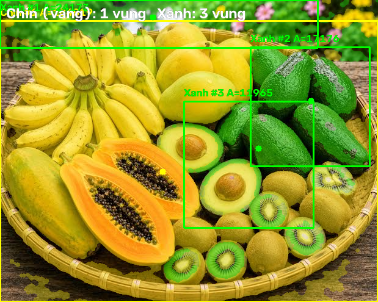
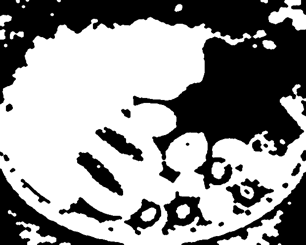
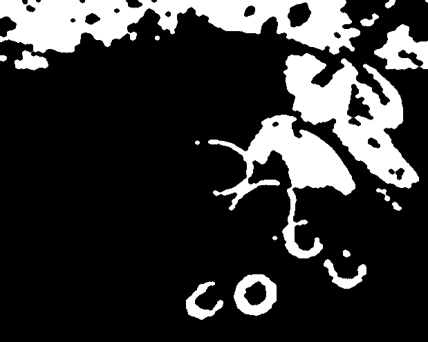

# Bài tập OpenCV: Nhận diện quả chín / quả xanh trong ảnh (BGR)

Chương trình đọc một ảnh, phân loại từng pixel thành **quả chín (vàng)** hoặc
**quả xanh**, rồi khoanh các vùng quả tìm được lên ảnh kết quả.

Ba ảnh mẫu đi kèm repo nên có thể chạy ngay sau khi clone:

```text
images/chuoixanh_chin2.jpg
images/anh_dudu.webp
images/anh_hoaqua.jpg
```

Kết quả mong đợi với ảnh mẫu mặc định `chuoixanh_chin2.jpg`:

- 1 vùng quả chín ở nửa trái ảnh.
- 1 vùng quả xanh ở nửa phải ảnh.

## Ảnh mẫu và kết quả

| Ảnh đầu vào | Kết quả | Mask quả chín | Mask quả xanh |
|-------------|---------|---------------|---------------|
|  |  |  |  |
|  |  |  |  |
|  |  |  |  |

- **Ảnh đầu vào**: ảnh gốc cần xử lý.
- **Kết quả**: vùng chín tô vàng, vùng xanh tô xanh lá, kèm khung, tâm và nhãn.
- **Mask**: ảnh đen trắng; pixel trắng (255) là pixel thuộc vùng quả, pixel đen
  (0) là không thuộc vùng quả. Hai mask này là dữ liệu trung gian để tìm contour.

### Các ảnh mẫu khác

| Ảnh | Kích thước | Kết quả với ngưỡng mặc định |
|-----|------------|-----------------------------|
| `images/anh_dudu.webp` | 720×480 | 1 vùng chín (34.223 px), 2 vùng xanh (256.894 px) |
| `images/anh_hoaqua.jpg` | 619×495 | 1 vùng chín (184.819 px), 3 vùng xanh (53.314 px) |

Hai ảnh này dùng để thử phân vùng màu trên ảnh khác nền/ánh sáng. Kết quả chỉ là
các vùng có màu tương ứng, không khẳng định chính xác loại quả trong ảnh.
Kết quả và mask mẫu của cả ba ảnh nằm trong `images/samples/`.

Chạy tất cả ảnh mẫu cùng lúc:

```bat
run_all.bat
```

Kết quả được lưu vào thư mục `output/`.

## 1. Bài toán và ý tưởng

Mỗi pixel trong ảnh màu có 3 thành phần màu. OpenCV lưu ảnh theo thứ tự
**B, G, R** (Blue, Green, Red), khác với cách viết thông thường là RGB.

- Quả chín (chuối vàng) có kênh **R** và **G** khá gần nhau.
- Quả xanh có kênh **G** lớn hơn **R** rõ rệt.
- Nền trắng/xám có 3 kênh gần bằng nhau.
- Vùng quá tối có giá trị màu thấp, không đủ tin cậy để phân loại.

Vì vậy chương trình không cần học máy hay nhận diện vật thể phức tạp; chỉ cần
so sánh tỉ lệ giữa các kênh màu, sau đó lọc nhiễu và tìm vùng liên thông.

### Quy tắc phân loại từng pixel

| Điều kiện | Kết quả |
|-----------|---------|
| `max(R,G,B) < 50` | bỏ qua (quá tối) |
| `max(R,G,B) - min(R,G,B) < 25` | bỏ qua (nền trắng / gần xám) |
| `B > 0.75 * G` | bỏ qua (ánh xanh dương) |
| `G >= 1.06 * R` | **quả xanh** |
| còn lại | **quả chín (vàng)** |

Có thể viết lại thành pseudocode:

```text
for moi pixel (B, G, R):
    neu max(B,G,R) < 50:            bo qua
    neu max(B,G,R) - min(B,G,R) < 25: bo qua
    neu B > 0.75 * G:               bo qua

    neu G >= 1.06 * R:
        mask_xanh[pixel] = 255
    nguoc lai:
        mask_chin[pixel] = 255
```

Phân loại xong, ta có 2 mask nhị phân: một mask cho quả chín, một mask cho quả
xanh. Bước tiếp theo là làm sạch mask và tìm các vùng quả.

## 2. Vì sao dùng `G/R` và `B/G`?

### Tỉ lệ `G/R` để tách chín và xanh

Dùng tỉ lệ thay vì giá trị tuyệt đối giúp chương trình bớt phụ thuộc vào độ sáng
của ảnh. Khi ảnh tối hơn hoặc sáng hơn, cả `G` và `R` thường cùng giảm hoặc cùng
tăng, nhưng tỉ lệ `G/R` vẫn tương đối ổn định.

- Quả chín: `R` và `G` gần nhau → `G/R` nhỏ, thường khoảng 0.85–1.0.
- Quả xanh: `G` lớn hơn `R` rõ rệt → `G/R` lớn, thường lớn hơn 1.1.
- Ngưỡng mặc định **1.06** nằm giữa hai nhóm.

### Tỉ lệ `B/G` để loại vùng ám xanh dương

Một số vùng nền, phản sáng hoặc vật thể lạ có kênh `B` cao bất thường. Chúng
không đại diện cho vỏ chuối nhưng có thể lọt vào mask nếu chỉ xét `G/R`.

Điều kiện `B > 0.75 * G` loại các pixel có màu xanh dương quá mạnh. Ngưỡng này
không loại quả xanh lá vì quả xanh lá có `B` nhỏ hơn `G` khá nhiều.

### Độ sáng và chênh màu để loại nền

- `max(R,G,B) < 50`: vùng quá tối, màu bị nhiễu, không nên phân loại.
- `max - min < 25`: nền trắng hoặc xám vì ba kênh gần bằng nhau. Nếu không loại,
  nền trắng sẽ bị coi là quả chín.

## 3. Ví dụ tính tay

Giả sử pixel có thứ tự **(B, G, R)**:

| Pixel | Giá trị (B,G,R) | `max` | `max-min` | `B/G` | `G/R` | Kết quả |
|-------|------------------|-------|-----------|-------|-------|---------|
| Vàng chín | (0, 220, 240) | 240 | 240 | 0.00 | 0.92 | **Quả chín** |
| Xanh lá | (50, 200, 130) | 200 | 150 | 0.25 | 1.54 | **Quả xanh** |
| Nền trắng | (255, 255, 255) | 255 | 0 | 1.00 | 1.00 | **Bỏ qua** |

Cách đọc từng dòng:

**Pixel vàng chín (0, 220, 240)**

1. `max = 240 >= 50` → đủ sáng, tiếp tục.
2. `max - min = 240 >= 25` → có màu rõ ràng, tiếp tục.
3. `B/G = 0 / 220 = 0 <= 0.75` → không ám xanh dương, tiếp tục.
4. `G/R = 220 / 240 = 0.92 < 1.06` → **quả chín**.

**Pixel xanh lá (50, 200, 130)**

1. `max = 200 >= 50` → đủ sáng.
2. `max - min = 200 - 50 = 150 >= 25` → có màu rõ ràng.
3. `B/G = 50 / 200 = 0.25 <= 0.75` → không bị loại.
4. `G/R = 200 / 130 = 1.54 >= 1.06` → **quả xanh**.

**Pixel nền trắng (255, 255, 255)**

1. `max = 255 >= 50` → đủ sáng.
2. `max - min = 255 - 255 = 0 < 25` → **bỏ qua** vì là nền trắng/xám.

## 4. Các bước xử lý chi tiết

### Bước 1: Đọc ảnh

Chương trình dùng `cv::imread` để đọc ảnh thành ma trận 3 kênh BGR. Nếu đường
dẫn sai hoặc file không phải ảnh, chương trình báo lỗi và dừng.

### Bước 2: Phân loại từng pixel

Với mỗi pixel:

1. Tính `max` và `min` của ba kênh.
2. Loại pixel quá tối hoặc quá ít chênh lệch màu.
3. Loại pixel ám xanh dương.
4. So sánh `G/R` để ghi 255 vào mask chín hoặc mask xanh.

Kết quả là 2 ảnh nhị phân cùng kích thước với ảnh gốc.

### Bước 3: Làm sạch mask bằng morphology

Mask thô thường có đốm nhiễu nhỏ và lỗ hổng. Chương trình dùng kernel ellipse
kích thước 7 và thực hiện:

- **Open** (`MORPH_OPEN`): xóa các đốm trắng nhỏ rải rác.
- **Close** (`MORPH_CLOSE`): lấp lỗ đen nhỏ bên trong vùng quả và nối các vùng
  bị đứt nhẹ.

Thứ tự open rồi close giúp mask sạch hơn nhưng vẫn giữ hình dạng tổng thể của
vùng quả.

### Bước 4: Tìm contour

Với mỗi mask, chương trình gọi `cv::findContours` để lấy đường bao các vùng
trắng. Chế độ `RETR_EXTERNAL` chỉ lấy đường bao ngoài cùng, phù hợp khi mỗi vùng
quả là một khối liền.

Sau đó:

- `cv::contourArea` tính diện tích vùng.
- Bỏ các contour có diện tích nhỏ hơn `minArea` (mặc định 3000 pixel).
- `cv::boundingRect` tạo khung chữ nhật bao quanh vùng.
- `cv::moments` tính tâm vùng quả.

### Bước 5: Sắp xếp và vẽ

Các vùng quả chín được đặt trước các vùng quả xanh. Trong mỗi nhóm, vùng có diện
tích lớn hơn được xếp trước và đánh số `#1`, `#2`, ...

Mỗi vùng được vẽ:

- Khung chữ nhật màu vàng (chín) hoặc xanh lá (xanh).
- Chấm tròn tại tâm vùng.
- Nhãn dạng `Chin #1 A=156445` hoặc `Xanh #1 A=119336`, trong đó `A` là diện
  tích contour.

### Bước 6: Lưu kết quả

Chế độ mặc định lưu 3 file:

- `ketqua_chuoi.png`: ảnh gốc đã tô màu và khoanh vùng.
- `mask_chin.png`: mask nhị phân của vùng chín.
- `mask_xanh.png`: mask nhị phân của vùng xanh.

Có thể đổi tên bằng tham số dòng lệnh.

## 5. Cấu trúc code

| File | Nhiệm vụ |
|------|----------|
| `src/main.cpp` | Đọc tham số, mở cửa sổ, tạo trackbar, gọi xử lý, lưu file |
| `src/ripeness.cpp` | Duyệt pixel, áp dụng ngưỡng BGR, tạo 2 mask, morphology |
| `src/fruit_detector.cpp` | Tìm contour, lọc diện tích, tính tâm, sắp xếp, vẽ |
| `include/vision/ripeness.hpp` | Khai báo `RgbThresholds`, `RipenessMasks` |
| `include/vision/fruit_detector.hpp` | Khai báo `Ripeness`, `FruitRegion`, API |
| `include/vision/opencv_compat.hpp` | Tương thích OpenCV 4 / 5 |
| `tests/test_ripeness.cpp` | Test phân loại pixel và morphology |
| `tests/test_fruit_detector.cpp` | Test tìm vùng, lọc `minArea`, vẽ |

Luồng gọi chính:

```text
main()
  → imread()                      đọc ảnh BGR
  → segmentByRipeness()           tạo mask chín + mask xanh
  → detectFruits()                tìm và sắp xếp các vùng quả
      → regionsFromMask()         findContours + contourArea + moments
  → buildResult()                 tô màu và vẽ vùng
  → imwrite()                     lưu ảnh kết quả + mask
```

## 6. Cấu trúc thư mục

```text
BaiTap_ChuoiXanhChin/
├── CMakeLists.txt
├── run.bat                       # build + chạy một ảnh trên Windows/MSYS2
├── run_all.bat                   # build + chạy tất cả ảnh trong images/
├── images/
│   ├── chuoixanh_chin2.jpg       # ảnh đầu vào mẫu
│   ├── anh_dudu.webp             # ảnh đầu vào mẫu
│   ├── anh_hoaqua.jpg            # ảnh đầu vào mẫu
│   └── samples/                  # kết quả mẫu của cả 3 ảnh
│       ├── ketqua_chuoi.png
│       ├── mask_chin.png
│       ├── mask_xanh.png
│       ├── anh_dudu_ketqua.png
│       ├── anh_dudu_mask_chin.png
│       ├── anh_dudu_mask_xanh.png
│       ├── anh_hoaqua_ketqua.png
│       ├── anh_hoaqua_mask_chin.png
│       └── anh_hoaqua_mask_xanh.png
├── output/                       # sinh ra khi chạy run_all.bat
├── include/vision/
│   ├── ripeness.hpp
│   ├── fruit_detector.hpp
│   └── opencv_compat.hpp
├── src/
│   ├── ripeness.cpp
│   ├── fruit_detector.cpp
│   └── main.cpp
└── tests/
    ├── test_util.hpp
    ├── test_ripeness.cpp
    └── test_fruit_detector.cpp
```

## 7. Yêu cầu

- CMake >= 3.16.
- Trình biên dịch hỗ trợ C++17.
- OpenCV >= 4.x.

Windows (MSYS2 MinGW64):

```bat
pacman -S mingw-w64-x86_64-cmake mingw-w64-x86_64-gcc mingw-w64-x86_64-opencv
```

## 8. Build và chạy

### Cách nhanh trên Windows

```bat
run.bat
run.bat --no-gui
run.bat images\chuoixanh_chin2.jpg
```

`run.bat` tự thêm `C:\msys64\mingw64\bin` vào `PATH`, cấu hình CMake, build và
chạy chương trình. Nếu MSYS2 cài ở thư mục khác, sửa biến `MSYS` ở đầu file.
Script cũng đặt `OPENCV_UI_BACKEND=WIN32` để cửa sổ hiển thị ổn định trên Windows.

Nếu chạy trực tiếp `build\detect.exe`, đặt biến môi trường tương tự:

```bat
set OPENCV_UI_BACKEND=WIN32
build\detect.exe
```

### Chạy tất cả ảnh cùng lúc

```bat
run_all.bat
```

`run_all.bat` xử lý mọi file ảnh trong `images/` (`.jpg`, `.jpeg`, `.png`,
`.webp`, `.bmp`) và ghi kết quả vào `output/`:

```text
output/
├── anh_dudu_ketqua.png
├── anh_dudu_mask_chin.png
├── anh_dudu_mask_xanh.png
├── anh_hoaqua_ketqua.png
├── chuoixanh_chin2_ketqua.png
└── ...
```

Script không xử lý các ảnh kết quả mẫu trong `images/samples/`. Nếu chưa có
`build/detect.exe`, script tự cấu hình và build trước.

Chạy riêng từng ảnh mới:

```bat
run.bat images\anh_dudu.webp
run.bat images\anh_hoaqua.jpg
```

### Build thủ công

```bash
cmake -S . -B build -DCMAKE_BUILD_TYPE=Release
cmake --build build -j
```

Chạy từ thư mục gốc của repo:

```bat
build\detect.exe                                  REM dùng ảnh mẫu trong repo
build\detect.exe images\chuoixanh_chin2.jpg
build\detect.exe --no-gui
build\detect.exe --min-area 5000
build\detect.exe -h
```

Lưu ý: đường dẫn ảnh được hiểu theo thư mục hiện tại. Nên chạy lệnh từ thư mục
gốc repo để đường dẫn mặc định `images/chuoixanh_chin2.jpg` hoạt động đúng.

## 9. Tham số dòng lệnh

| Tham số | Ý nghĩa |
|---------|----------|
| `<ảnh>` | Ảnh đầu vào (mặc định `images/chuoixanh_chin2.jpg`) |
| `-o`, `--out <path>` | Ảnh kết quả (mặc định `ketqua_chuoi.png`) |
| `--mask-chin <path>` | Mask quả chín (mặc định `mask_chin.png`) |
| `--mask-xanh <path>` | Mask quả xanh (mặc định `mask_xanh.png`) |
| `-m`, `--min-area <n>` | Diện tích contour tối thiểu (mặc định 3000) |
| `--no-gui` | Không mở cửa sổ, xử lý một lần rồi lưu file |
| `-h`, `--help` | Hiển thị hướng dẫn |

Ví dụ đổi tên file đầu ra:

```bat
build\detect.exe images\chuoixanh_chin2.jpg --no-gui -o out\ketqua.png --mask-chin out\chin.png --mask-xanh out\xanh.png
```

Chương trình tự tạo thư mục cha nếu chưa tồn tại.

## 10. Chế độ GUI và trackbar

Chế độ GUI mở 4 cửa sổ:

- **Qua chin / Qua xanh**: ảnh kết quả.
- **Mask qua chin**: mask nhị phân vùng chín.
- **Mask qua xanh**: mask nhị phân vùng xanh.
- **Chinh nguong mau**: nơi chỉnh 4 trackbar.

| Trackbar | Khoảng giá trị | Mặc định | Ý nghĩa |
|----------|----------------|----------|----------|
| `G/R xanh` | 0–200 | 106 | `G/R >= 1.06` → quả xanh |
| `B/G toi da` | 0–100 | 75 | `B/G > 0.75` → bỏ qua |
| `Sang toi thieu` | 0–255 | 50 | `max(R,G,B) >= 50` |
| `Chenh mau` | 0–150 | 25 | `max-min >= 25` |

Hai trackbar tỉ lệ được lưu dưới dạng phần trăm: `106` nghĩa là `1.06`, `75`
nghĩa là `0.75`.

| Phím | Chức năng |
|------|-----------|
| `q` / `ESC` | Thoát |
| `s` | Lưu ảnh kết quả + 2 mask |
| `m` | Đổi nhanh ngưỡng diện tích giữa 3000 và 10000 |
| `r` | Reset 4 ngưỡng BGR về mặc định |

## 11. Cách chọn ngưỡng với ảnh khác

Thứ tự chỉnh nên làm: **độ sáng/chênh màu → B/G → G/R → diện tích**.

| Hiện tượng | Cách chỉnh |
|------------|------------|
| Nền trắng/xám bị nhận là quả | Tăng `Chênh màu` (30–50) |
| Vùng tối, bóng đổ bị nhận là quả | Tăng `Sáng tối thiểu` (60–80) |
| Quả tối màu bị bỏ qua | Giảm `Sáng tối thiểu` (30–40) |
| Nền xanh dương lọt vào mask | Giảm `B/G tối đa` (0.60–0.70) |
| Quả xanh bị bỏ qua vì ám xanh dương | Tăng `B/G tối đa` (0.80–0.90) |
| Quả vàng bị nhận thành quả xanh | Tăng `G/R xanh` (1.08–1.12) |
| Quả xanh nhạt bị nhận thành quả chín | Giảm `G/R xanh` (1.00–1.04) |
| Nhiều đốm nhỏ bị khoanh | Tăng `--min-area` (5000–10000) |
| Quả nhỏ không được phát hiện | Giảm `--min-area` (500–2000) |

Quy trình gợi ý:

1. Chạy `run.bat` và quan sát cửa sổ **Chinh nguong mau**.
2. Chỉnh `Sang toi thieu` và `Chenh mau` để loại nền trước.
3. Chỉnh `B/G toi da` nếu nền hoặc vật thể ám xanh dương còn lọt.
4. Chỉnh `G/R xanh` cuối cùng để tách quả chín và quả xanh.
5. Nhấn `m` để đổi nhanh ngưỡng diện tích, nhấn `r` để reset.
6. Nhấn `s` để lưu kết quả.

## 12. Kết quả với ảnh mẫu

Chạy:

```bat
build\detect.exe --no-gui
```

Kết quả in ra console:

```text
Anh: images/chuoixanh_chin2.jpg (960x678)
Phan loai bang BGR: G/R >= 1.06 => xanh, B/G > 0.75 => bo qua,
do sang >= 50, chenh mau >= 25
Qua chin (vang): 1 vung, dien tich 156445
Qua xanh: 1 vung, dien tich 119336
Da luu ketqua_chuoi.png, mask_chin.png va mask_xanh.png
```

Tổng hợp với 3 ảnh mẫu (ngưỡng mặc định, `minArea = 3000`):

| Ảnh | Kích thước | Vùng chín | Vùng xanh |
|-----|------------|-----------|-----------|
| `images/chuoixanh_chin2.jpg` | 960×678 | 1 vùng, 156.445 px | 1 vùng, 119.336 px |
| `images/anh_dudu.webp` | 720×480 | 1 vùng, 34.223 px | 2 vùng, 256.894 px |
| `images/anh_hoaqua.jpg` | 619×495 | 1 vùng, 184.819 px | 3 vùng, 53.314 px |

Lưu ý: chương trình nhận diện **vùng quả chín / vùng quả xanh**, không đếm từng
quả riêng lẻ bên trong chùm. Nếu hai quả nằm sát nhau và cùng màu, chúng có thể
được gộp thành một vùng.

## 13. Xử lý sự cố

| Lỗi / hiện tượng | Cách khắc phục |
|------------------|----------------|
| `Khong doc duoc anh` | Kiểm tra đường dẫn; chạy từ thư mục gốc repo; thử `images\chuoixanh_chin2.jpg` |
| `run_all.bat` không thấy ảnh | Đặt ảnh trực tiếp trong `images/`; script không quét thư mục con |
| `cmake` không tìm thấy OpenCV | Truyền `-DOpenCV_DIR=.../lib/cmake/opencv4` hoặc `opencv5` |
| Thiếu DLL khi chạy `detect.exe` | Thêm `C:\msys64\mingw64\bin` vào `PATH`, hoặc chạy bằng `run.bat` |
| Không mở được cửa sổ | Chạy bằng `run.bat` (đã đặt `OPENCV_UI_BACKEND=WIN32`) hoặc tự `set OPENCV_UI_BACKEND=WIN32`; nếu vẫn không được, dùng `--no-gui` |
| Không có vùng quả nào | Giảm `Sang toi thieu`, giảm `Chenh mau`, giảm `--min-area` |
| Quá nhiều vùng nhỏ | Tăng `--min-area` |
| Nền bị nhận là quả | Tăng `Chenh mau`; giảm `B/G toi da` nếu nền ám xanh dương |
| Quả chín bị nhận là xanh | Tăng `G/R xanh` |
| Quả xanh bị nhận là chín | Giảm `G/R xanh` |

## 14. Giới hạn

- Chương trình giả định quả chín có màu vàng và quả xanh có màu xanh lá.
- Ngưỡng mặc định được chọn cho ảnh mẫu; ảnh có ánh sáng hoặc nền rất khác có
  thể cần chỉnh trackbar.
- Vùng bị che khuất mạnh, cháy sáng hoặc có màu gần với nền có thể bị bỏ sót.
- Đây là bài toán phân vùng màu, không phải nhận diện từng quả riêng lẻ.

## 15. Test

```bash
cmake -S . -B build
cmake --build build -j
ctest --test-dir build --output-on-failure
```

- `test_ripeness`: kiểm tra phân loại pixel vàng/xanh, loại nền trắng, vật xanh
  dương, pixel tối, nhiễu 1 pixel và thay đổi ngưỡng `G/R`.
- `test_fruit_detector`: kiểm tra phát hiện 1 vùng chín + 1 vùng xanh, lọc
  `minArea`, sắp xếp và vẽ kết quả.
